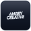
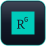

<p align="center">
  
</p>

<p align="center">
  <a href="https://www.linkedin.com/in/krishntundia"></a>
  <a href="https://huggingface.co/KrishnTundia"></a>
  <a href="https://www.instagram.com/krishn.tundia/"></a>
  <a href="mailto:krishntundia13072001@gmail.com"></a>
</p>

<!-- MESH:START -->
<p align="center">
  <a href="https://11ty.dev" title="Eleventy"></a>
  
  <a href="https://42.fr" title="42 Group"></a>
  
  <a href="https://500px.com" title="500px"></a>
  
  <a href="https://fontawesome.com/icons/brands/solid/a11y-project" title="A11y Project"></a>
  
  <a href="https://accessibleicon.org" title="Accessible Icon"></a>
  
  <a href="https://accusoft.com" title="Accusoft"></a>
  
  <a href="https://fontawesome.com/icons/brands/solid/adn" title="Adn"></a>
  
  <a href="https://fontawesome.com/icons/brands/solid/adversal" title="Adversal"></a>
  <br />
  
  <a href="https://fontawesome.com/icons/brands/solid/affiliatetheme" title="Affiliatetheme"></a>
  
  <a href="https://www.airbnb.com" title="Airbnb"></a>
  
  <a href="https://www.algolia.com" title="Algolia"></a>
  
  <a href="https://www.alipay.com" title="Alipay"></a>
  
  <a href="https://pay.amazon.com" title="Amazon Pay"></a>
  
  <a href="https://www.amazon.com" title="Amazon"></a>
  
  <a href="https://fontawesome.com/icons/brands/solid/amilia" title="Amilia"></a>
  
  <br />
  <a href="https://www.android.com" title="Android"></a>
  
  <a href="https://fontawesome.com/icons/brands/solid/angellist" title="Angellist"></a>
  
  <a href="https://fontawesome.com/icons/brands/solid/angrycreative" title="Angrycreative"></a>
  
  <a href="https://angular.dev" title="Angular"></a>
  
  <a href="https://www.apple.com/app-store" title="App Store"></a>
  
  <a href="https://www.apple.com/app-store" title="App Store"></a>
  
  <a href="https://fontawesome.com/icons/brands/solid/apper" title="Apper"></a>
  
  <a href="https://www.apple.com/apple-pay" title="Apple Pay"></a>
  <br />
  
  <a href="https://www.apple.com" title="Apple"></a>
  
  <a href="https://wiki.archlinux.org" title="Arch Linux"></a>
  
  <a href="https://www.artstation.com" title="ArtStation"></a>
  
  <a href="https://fontawesome.com/icons/brands/solid/asymmetrik" title="Asymmetrik"></a>
  
  <a href="https://www.atlassian.com" title="Atlassian"></a>
  
  <a href="https://fontawesome.com/icons/brands/solid/audible" title="Audible"></a>
  
  <a href="https://github.com/postcss/autoprefixer" title="Autoprefixer"></a>
  
  <br />
  <a href="https://fontawesome.com/icons/brands/solid/avianex" title="Avianex"></a>
  
  <a href="https://fontawesome.com/icons/brands/solid/aviato" title="Aviato"></a>
  
  <a href="https://aws.amazon.com" title="Aws"></a>
  
  <a href="https://bandcamp.com" title="Bandcamp"></a>
  
  <a href="https://www.blizzard.com" title="Battle.net"></a>
  
  <a href="https://www.behance.net" title="Behance"></a>
  
  <a href="https://www.behance.net" title="Behance"></a>
  
  <a href="https://fontawesome.com/icons/brands/solid/bgg" title="Bgg"></a>
  <br />
  
  <a href="https://bilibili.com" title="Bilibili"></a>
  
  <a href="https://fontawesome.com/icons/brands/solid/bimobject" title="Bimobject"></a>
  
  <a href="https://bitbucket.org" title="Bitbucket"></a>
  
  <a href="https://bitcoin.org" title="Bitcoin"></a>
  
  <a href="https://fontawesome.com/icons/brands/solid/bity" title="Bity"></a>
  
  <a href="https://fontawesome.com/icons/brands/solid/black-tie" title="Black Tie"></a>
  
  <a href="https://blackberry.com" title="Blackberry"></a>
  
  <br />
  <a href="https://blogger.com" title="Blogger"></a>
  
  <a href="https://blogger.com" title="Blogger"></a>
  
  <a href="https://bsky.app" title="Bluesky"></a>
  
  <a href="https://bluetooth.com" title="Bluetooth"></a>
  
  <a href="https://bluetooth.com" title="Bluetooth"></a>
  
  <a href="https://boardgamegeek.com" title="BoardGameGeek"></a>
  
  <a href="https://getbootstrap.com" title="Bootstrap"></a>
  
  <a href="https://fontawesome.com/icons/brands/solid/bots" title="Bots"></a>
  <br />
  
  <a href="https://fontawesome.com/icons/brands/solid/brave-reverse" title="Brave Reverse"></a>
  
  <a href="https://brave.com" title="Brave"></a>
  
  <a href="https://bitcoin.org" title="Btc"></a>
  
  <a href="https://buffer.com" title="Buffer"></a>
  
  <a href="https://fontawesome.com/icons/brands/solid/build-awesome" title="Build Awesome"></a>
  
  <a href="https://fontawesome.com/icons/brands/solid/buromobelexperte" title="Buromobelexperte"></a>
  
  <a href="https://fontawesome.com/icons/brands/solid/buy-n-large" title="Buy N Large"></a>
  
  <br />
  <a href="https://buysellads.com" title="BuySellAds"></a>
  
  <a href="https://fontawesome.com/icons/brands/solid/canadian-maple-leaf" title="Canadian Maple Leaf"></a>
  
  <a href="https://cash.app" title="Cash App"></a>
  
  <a href="https://pay.amazon.com" title="Cc Amazon Pay"></a>
  
  <a href="https://fontawesome.com/icons/brands/solid/cc-amex" title="Cc Amex"></a>
  
  <a href="https://www.apple.com/apple-pay" title="Apple Pay"></a>
  
  <a href="https://dinersclub.com" title="Diners Club"></a>
  
  <a href="https://discovernetwork.com" title="Discover"></a>
  <br />
  
  <a href="https://global.jcb" title="JCB"></a>
  
  <a href="https://www.mastercard.com" title="MasterCard"></a>
  
  <a href="https://www.paypal.com" title="PayPal"></a>
  
  <a href="https://stripe.com" title="Stripe"></a>
  
  <a href="https://www.visa.com" title="Visa"></a>
  
  <a href="https://fontawesome.com/icons/brands/solid/centercode" title="Centercode"></a>
  
  <a href="https://www.centos.org" title="CentOS"></a>
  
  <br />
  <a href="https://www.google.com/chrome" title="Chrome"></a>
  
  <a href="https://partnermarketinghub.withgoogle.com" title="Google Cast"></a>
  
  <a href="https://fontawesome.com/icons/brands/solid/circle-zulip" title="Circle Zulip"></a>
  
  <a href="https://claude.ai" title="Claude"></a>
  
  <a href="https://www.cloudflare.com" title="Cloudflare"></a>
  
  <a href="https://fontawesome.com/icons/brands/solid/cloudscale" title="Cloudscale"></a>
  
  <a href="https://cloudsmith.com" title="Cloudsmith"></a>
  
  <a href="https://fontawesome.com/icons/brands/solid/cloudversify" title="Cloudversify"></a>
  <br />
  
  <a href="https://fontawesome.com/icons/brands/solid/cmplid" title="Cmplid"></a>
  
  <a href="https://codeberg.org" title="Codeberg"></a>
  
  <a href="https://codepen.io" title="Codepen"></a>
  
  <a href="https://fontawesome.com/icons/brands/solid/codiepie" title="Codiepie"></a>
  
  <a href="https://www.atlassian.com/software/confluence" title="Confluence"></a>
  
  <a href="https://fontawesome.com/icons/brands/solid/connectdevelop" title="Connectdevelop"></a>
  
  <a href="https://contao.org" title="Contao"></a>
  
  <br />
  <a href="https://fontawesome.com/icons/brands/solid/copilot" title="Copilot"></a>
  
  <a href="https://fontawesome.com/icons/brands/solid/cotton-bureau" title="Cotton Bureau"></a>
  
  <a href="https://cpanel.net" title="cPanel"></a>
  
  <a href="https://fontawesome.com/icons/brands/solid/creative-commons-by" title="Creative Commons By"></a>
  
  <a href="https://fontawesome.com/icons/brands/solid/creative-commons-nc-eu" title="Creative Commons Nc Eu"></a>
  
  <a href="https://fontawesome.com/icons/brands/solid/creative-commons-nc-jp" title="Creative Commons Nc Jp"></a>
  
  <a href="https://fontawesome.com/icons/brands/solid/creative-commons-nc" title="Creative Commons Nc"></a>
  
  <a href="https://fontawesome.com/icons/brands/solid/creative-commons-nd" title="Creative Commons Nd"></a>
  <br />
  
  <a href="https://fontawesome.com/icons/brands/solid/creative-commons-pd-alt" title="Creative Commons Pd Alt"></a>
  
  <a href="https://fontawesome.com/icons/brands/solid/creative-commons-pd" title="Creative Commons Pd"></a>
  
  <a href="https://fontawesome.com/icons/brands/solid/creative-commons-remix" title="Creative Commons Remix"></a>
  
  <a href="https://fontawesome.com/icons/brands/solid/creative-commons-sa" title="Creative Commons Sa"></a>
  
  <a href="https://fontawesome.com/icons/brands/solid/creative-commons-sampling-plus" title="Creative Commons Sampling Plus"></a>
  
  <a href="https://fontawesome.com/icons/brands/solid/creative-commons-sampling" title="Creative Commons Sampling"></a>
  
  <a href="https://fontawesome.com/icons/brands/solid/creative-commons-share" title="Creative Commons Share"></a>
  
  <br />
  <a href="https://fontawesome.com/icons/brands/solid/creative-commons-zero" title="Creative Commons Zero"></a>
  
  <a href="https://creativecommons.org" title="Creative Commons"></a>
  
  <a href="https://critrole.com" title="Critical Role"></a>
  
  <a href="https://developer.mozilla.org/en-US/docs/Web/CSS" title="CSS"></a>
  
  <a href="https://developer.mozilla.org/en-US/docs/Web/CSS" title="Css3 Alt"></a>
  
  <a href="https://developer.mozilla.org/en-US/docs/Web/CSS" title="Css3"></a>
  
  <a href="https://fontawesome.com/icons/brands/solid/cuttlefish" title="Cuttlefish"></a>
  
  <a href="https://fontawesome.com/icons/brands/solid/d-and-d-beyond" title="D And D Beyond"></a>
  <br />
  
  <a href="https://fontawesome.com/icons/brands/solid/d-and-d" title="D And D"></a>
  
  <a href="https://careers.dailymotion.com" title="Dailymotion"></a>
  
  <a href="https://dart.dev" title="Dart"></a>
  
  <a href="https://fontawesome.com/icons/brands/solid/dashcube" title="Dashcube"></a>
  
  <a href="https://www.debian.org" title="Debian"></a>
  
  <a href="https://deezerbrand.com" title="Deezer"></a>
  
  <a href="https://fontawesome.com/icons/brands/solid/delicious" title="Delicious"></a>
  
  <br />
  <a href="https://fontawesome.com/icons/brands/solid/deploydog" title="Deploydog"></a>
  
  <a href="https://fontawesome.com/icons/brands/solid/deskpro" title="Deskpro"></a>
  
  <a href="https://dev.to" title="Dev"></a>
  
  <a href="https://www.deviantart.com" title="DeviantArt"></a>
  
  <a href="https://github.com/challengepost/supportcenter" title="Devpost"></a>
  
  <a href="https://dpdhl-brands.com" title="DHL"></a>
  
  <a href="https://wiki.diasporafoundation.org" title="Diaspora"></a>
  
  <a href="https://digg.com" title="Digg"></a>
  <br />
  
  <a href="https://www.digitalocean.com" title="DigitalOcean"></a>
  
  <a href="https://discord.com" title="Discord"></a>
  
  <a href="https://discourse.org" title="Discourse"></a>
  
  <a href="https://disqus.com" title="Disqus"></a>
  
  <a href="https://fontawesome.com/icons/brands/solid/dochub" title="Dochub"></a>
  
  <a href="https://www.docker.com" title="Docker"></a>
  
  <a href="https://github.com/Dolibarr/dolibarr-foundation" title="Dolibarr"></a>
  
  <br />
  <a href="https://fontawesome.com/icons/brands/solid/draft2digital" title="Draft2digital"></a>
  
  <a href="https://dribbble.com" title="Dribbble"></a>
  
  <a href="https://dribbble.com" title="Dribbble"></a>
  
  <a href="https://www.dropbox.com" title="Dropbox"></a>
  
  <a href="https://www.drupal.org" title="Drupal"></a>
  
  <a href="https://duolingo.com" title="Duolingo"></a>
  
  <a href="https://fontawesome.com/icons/brands/solid/dyalog" title="Dyalog"></a>
  
  <a href="https://fontawesome.com/icons/brands/solid/earlybirds" title="Earlybirds"></a>
  <br />
  
  <a href="https://www.ebay.com" title="eBay"></a>
  
  <a href="https://fontawesome.com/icons/brands/solid/edge-legacy" title="Edge Legacy"></a>
  
  <a href="https://www.microsoft.com/edge" title="Edge"></a>
  
  <a href="https://elementor.com" title="Elementor"></a>
  
  <a href="https://11ty.dev" title="Eleventy"></a>
  
  <a href="https://fontawesome.com/icons/brands/solid/ello" title="Ello"></a>
  
  <a href="https://fontawesome.com/icons/brands/solid/ember" title="Ember"></a>
  
  <br />
  <a href="https://fontawesome.com/icons/brands/solid/empire" title="Empire"></a>
  
  <a href="https://fontawesome.com/icons/brands/solid/envira" title="Envira"></a>
  
  <a href="https://github.com/erlang/erlide_eclipse" title="Erlang"></a>
  
  <a href="https://ethereum.org" title="Ethereum"></a>
  
  <a href="https://www.etsy.com" title="Etsy"></a>
  
  <a href="https://evernote.com" title="Evernote"></a>
  
  <a href="https://fontawesome.com/icons/brands/solid/expeditedssl" title="Expeditedssl"></a>
  
  <a href="https://www.facebook.com" title="Facebook"></a>
  <br />
  
  <a href="https://www.facebook.com" title="Facebook"></a>
  
  <a href="https://www.facebook.com" title="Facebook"></a>
  
  <a href="https://www.facebook.com" title="Facebook"></a>
  
  <a href="https://fontawesome.com/icons/brands/solid/fantasy-flight-games" title="Fantasy Flight Games"></a>
  
  <a href="https://fedex.com" title="FedEx"></a>
  
  <a href="https://fontawesome.com/icons/brands/solid/fediverse" title="Fediverse"></a>
  
  <a href="https://fedoraproject.org" title="Fedora"></a>
  
  <br />
  <a href="https://www.figma.com" title="Figma"></a>
  
  <a href="https://fontawesome.com/icons/brands/solid/files-pinwheel" title="Files Pinwheel"></a>
  
  <a href="https://www.mozilla.org/firefox" title="Firefox Browser"></a>
  
  <a href="https://www.mozilla.org/firefox" title="Firefox"></a>
  
  <a href="https://fontawesome.com/icons/brands/solid/first-order-alt" title="First Order Alt"></a>
  
  <a href="https://fontawesome.com/icons/brands/solid/first-order" title="First Order"></a>
  
  <a href="https://fontawesome.com/icons/brands/solid/firstdraft" title="Firstdraft"></a>
  
  <a href="https://www.flickr.com" title="Flickr"></a>
  <br />
  
  <a href="https://flipboard.com" title="Flipboard"></a>
  
  <a href="https://flutter.dev" title="Flutter"></a>
  
  <a href="https://fontawesome.com/icons/brands/solid/fly" title="Fly"></a>
  
  <a href="https://fontawesome.com" title="Font Awesome"></a>
  
  <a href="https://fontawesome.com/icons/brands/solid/font-awesome-flag" title="Font Awesome Flag"></a>
  
  <a href="https://fontawesome.com/icons/brands/solid/font-awesome-logo-full" title="Font Awesome Logo Full"></a>
  
  <a href="https://fontawesome.com" title="Font Awesome"></a>
  
  <br />
  <a href="https://fontawesome.com/icons/brands/solid/fonticons-fi" title="Fonticons Fi"></a>
  
  <a href="https://fontawesome.com/icons/brands/solid/fonticons" title="Fonticons"></a>
  
  <a href="https://codeberg.org" title="Forgejo"></a>
  
  <a href="https://fontawesome.com/icons/brands/solid/fort-awesome-alt" title="Fort Awesome Alt"></a>
  
  <a href="https://fontawesome.com/icons/brands/solid/fort-awesome" title="Fort Awesome"></a>
  
  <a href="https://fontawesome.com/icons/brands/solid/forumbee" title="Forumbee"></a>
  
  <a href="https://foursquare.com" title="Foursquare"></a>
  
  <a href="https://www.freecodecamp.org" title="freeCodeCamp"></a>
  <br />
  
  <a href="https://freebsdfoundation.org" title="FreeBSD"></a>
  
  <a href="https://fontawesome.com/icons/brands/solid/fulcrum" title="Fulcrum"></a>
  
  <a href="https://fontawesome.com/icons/brands/solid/galactic-republic" title="Galactic Republic"></a>
  
  <a href="https://fontawesome.com/icons/brands/solid/galactic-senate" title="Galactic Senate"></a>
  
  <a href="https://fontawesome.com/icons/brands/solid/get-pocket" title="Get Pocket"></a>
  
  <a href="https://fontawesome.com/icons/brands/solid/gg-circle" title="Gg Circle"></a>
  
  <a href="https://fontawesome.com/icons/brands/solid/gg" title="Gg"></a>
  
  <br />
  <a href="https://git-scm.com" title="Git"></a>
  
  <a href="https://git-scm.com" title="Git"></a>
  
  <a href="https://git-scm.com" title="Git"></a>
  
  <a href="https://gitee.com" title="Gitee"></a>
  
  <a href="https://github.com" title="GitHub"></a>
  
  <a href="https://github.com" title="GitHub"></a>
  
  <a href="https://github.com" title="GitHub"></a>
  
  <a href="https://gitkraken.com" title="GitKraken"></a>
  <br />
  
  <a href="https://gitlab.com" title="GitLab"></a>
  
  <a href="https://gitlab.com" title="GitLab"></a>
  
  <a href="https://gitter.im" title="Gitter"></a>
  
  <a href="https://glide.page" title="Glide"></a>
  
  <a href="https://glide.page" title="Glide"></a>
  
  <a href="https://fontawesome.com/icons/brands/solid/globaleaks" title="Globaleaks"></a>
  
  <a href="https://fontawesome.com/icons/brands/solid/gofore" title="Gofore"></a>
  
  <br />
  <a href="https://go.dev" title="Golang"></a>
  
  <a href="https://www.goodreads.com" title="Goodreads"></a>
  
  <a href="https://www.goodreads.com" title="Goodreads"></a>
  
  <a href="https://drive.google.com" title="Google Drive"></a>
  
  <a href="https://pay.google.com" title="Google Pay"></a>
  
  <a href="https://play.google.com" title="Google Play"></a>
  
  <a href="https://fontawesome.com/icons/brands/solid/google-plus-g" title="Google Plus G"></a>
  
  <a href="https://fontawesome.com/icons/brands/solid/google-plus-square" title="Google Plus Square"></a>
  <br />
  
  <a href="https://fontawesome.com/icons/brands/solid/google-plus" title="Google Plus"></a>
  
  <a href="https://scholar.google.com" title="Google Scholar"></a>
  
  <a href="https://fontawesome.com/icons/brands/solid/google-wallet" title="Google Wallet"></a>
  
  <a href="https://www.google.com" title="Google"></a>
  
  <a href="https://fontawesome.com/icons/brands/solid/gratipay" title="Gratipay"></a>
  
  <a href="https://getgrav.org" title="Grav"></a>
  
  <a href="https://fontawesome.com/icons/brands/solid/gripfire" title="Gripfire"></a>
  
  <br />
  <a href="https://github.com/gruntjs/grunt-docs" title="Grunt"></a>
  
  <a href="https://guilded.gg" title="Guilded"></a>
  
  <a href="https://gulpjs.com" title="gulp"></a>
  
  <a href="https://news.ycombinator.com" title="Hacker News Square"></a>
  
  <a href="https://news.ycombinator.com" title="Hacker News"></a>
  
  <a href="https://www.hackerrank.com" title="HackerRank"></a>
  
  <a href="https://hashnode.com" title="Hashnode"></a>
  
  <a href="https://fontawesome.com/icons/brands/solid/hips" title="Hips"></a>
  <br />
  
  <a href="https://fontawesome.com/icons/brands/solid/hire-a-helper" title="Hire A Helper"></a>
  
  <a href="https://hivehome.com" title="Hive"></a>
  
  <a href="https://fontawesome.com/icons/brands/solid/hooli" title="Hooli"></a>
  
  <a href="https://fontawesome.com/icons/brands/solid/hornbill" title="Hornbill"></a>
  
  <a href="https://hotjar.com" title="Hotjar"></a>
  
  <a href="https://houzz.com" title="Houzz"></a>
  
  <a href="https://developer.mozilla.org/en-US/docs/Web/HTML" title="HTML5"></a>
  
  <br />
  <a href="https://www.hubspot.com" title="HubSpot"></a>
  
  <a href="https://huggingface.co" title="Hugging Face"></a>
  
  <a href="https://fontawesome.com/icons/brands/solid/ideal" title="Ideal"></a>
  
  <a href="https://www.imdb.com" title="IMDb"></a>
  
  <a href="https://fontawesome.com/icons/brands/solid/innosoft" title="Innosoft"></a>
  
  <a href="https://www.instagram.com" title="Instagram"></a>
  
  <a href="https://www.instagram.com" title="Instagram"></a>
  
  <a href="https://fontawesome.com/icons/brands/solid/instalod" title="Instalod"></a>
  <br />
  
  <a href="https://www.intercom.com" title="Intercom"></a>
  
  <a href="https://archive.org" title="Internet Archive"></a>
  
  <a href="https://fontawesome.com/icons/brands/solid/internet-explorer" title="Internet Explorer"></a>
  
  <a href="https://fontawesome.com/icons/brands/solid/invision" title="Invision"></a>
  
  <a href="https://fontawesome.com/icons/brands/solid/ioxhost" title="Ioxhost"></a>
  
  <a href="https://itch.io" title="Itch.io"></a>
  
  <a href="https://fontawesome.com/icons/brands/solid/itunes-note" title="Itunes Note"></a>
  
  <br />
  <a href="https://fontawesome.com/icons/brands/solid/itunes" title="iTunes"></a>
  
  <a href="https://www.java.com" title="Java"></a>
  
  <a href="https://fontawesome.com/icons/brands/solid/jedi-order" title="Jedi Order"></a>
  
  <a href="https://www.jenkins.io" title="Jenkins"></a>
  
  <a href="https://www.atlassian.com/software/jira" title="Jira"></a>
  
  <a href="https://fontawesome.com/icons/brands/solid/joget" title="Joget"></a>
  
  <a href="https://www.joomla.org" title="Joomla"></a>
  
  <a href="https://developer.mozilla.org/en-US/docs/Web/JavaScript" title="Js Square"></a>
  <br />
  
  <a href="https://developer.mozilla.org/en-US/docs/Web/JavaScript" title="Js"></a>
  
  <a href="https://jsfiddle.net" title="JSFiddle"></a>
  
  <a href="https://github.com/JuliaLang/julia-logo-graphics" title="Julia"></a>
  
  <a href="https://fontawesome.com/icons/brands/solid/jxl" title="Jxl"></a>
  
  <a href="https://www.kaggle.com" title="Kaggle"></a>
  
  <a href="https://fontawesome.com/icons/brands/solid/kakao-talk" title="KakaoTalk"></a>
  
  <a href="https://github.com/keybase/client" title="Keybase"></a>
  
  <br />
  <a href="https://keycdn.com" title="KeyCDN"></a>
  
  <a href="https://fontawesome.com/icons/brands/solid/kickstarter-k" title="Kickstarter K"></a>
  
  <a href="https://www.kickstarter.com" title="Kickstarter"></a>
  
  <a href="https://more.ko-fi.com" title="Ko-fi"></a>
  
  <a href="https://fontawesome.com/icons/brands/solid/korvue" title="Korvue"></a>
  
  <a href="https://github.com/kubernetes/kubernetes" title="Kubernetes"></a>
  
  <a href="https://laravel.com" title="Laravel"></a>
  
  <a href="https://fontawesome.com/icons/brands/solid/lastfm-square" title="Last.fm"></a>
  <br />
  
  <a href="https://fontawesome.com/icons/brands/solid/lastfm" title="Last.fm"></a>
  
  <a href="https://leanpub.com" title="Leanpub"></a>
  
  <a href="https://leetcode.com" title="LeetCode"></a>
  
  <a href="https://lesscss.org" title="Less"></a>
  
  <a href="https://letsencrypt.org" title="Let's Encrypt"></a>
  
  <a href="https://letterboxd.com" title="Letterboxd"></a>
  
  <a href="https://line.me" title="LINE"></a>
  
  <br />
  <a href="https://www.linkedin.com" title="Linkedin In"></a>
  
  <a href="https://www.linkedin.com" title="Linkedin"></a>
  
  <a href="https://linktr.ee" title="Linktree"></a>
  
  <a href="https://fontawesome.com/icons/brands/solid/linode" title="Linode"></a>
  
  <a href="https://www.kernel.org" title="Linux"></a>
  
  <a href="https://fontawesome.com/icons/brands/solid/lumon-drop" title="Lumon Drop"></a>
  
  <a href="https://fontawesome.com/icons/brands/solid/lumon" title="Lumon"></a>
  
  <a href="https://www.lyft.com" title="Lyft"></a>
  <br />
  
  <a href="https://business.adobe.com/products/magento/magento-commerce.html" title="Magento"></a>
  
  <a href="https://mailchimp.com" title="MailChimp"></a>
  
  <a href="https://fontawesome.com/icons/brands/solid/mandalorian" title="Mandalorian"></a>
  
  <a href="https://daringfireball.net/projects/markdown" title="Markdown"></a>
  
  <a href="https://joinmastodon.org" title="Mastodon"></a>
  
  <a href="https://matrix.org" title="Matrix"></a>
  
  <a href="https://mattermost.org" title="Mattermost"></a>
  
  <br />
  <a href="https://fontawesome.com/icons/brands/solid/maxcdn" title="Maxcdn"></a>
  
  <a href="https://mdbootstrap.com" title="Mdb"></a>
  
  <a href="https://fontawesome.com/icons/brands/solid/medapps" title="Medapps"></a>
  
  <a href="https://fontawesome.com/icons/brands/solid/medium-m" title="Medium M"></a>
  
  <a href="https://medium.com" title="Medium"></a>
  
  <a href="https://fontawesome.com/icons/brands/solid/medrt" title="Medrt"></a>
  
  <a href="https://www.meetup.com" title="Meetup"></a>
  
  <a href="https://fontawesome.com/icons/brands/solid/megaport" title="Megaport"></a>
  <br />
  
  <a href="https://mendeley.com" title="Mendeley"></a>
  
  <a href="https://www.meta.com" title="Meta"></a>
  
  <a href="https://micro.blog" title="Micro.blog"></a>
  
  <a href="https://www.microsoft.com" title="Microsoft"></a>
  
  <a href="https://fontawesome.com/icons/brands/solid/mintbit" title="Mintbit"></a>
  
  <a href="https://mix.com" title="Mix"></a>
  
  <a href="https://mixcloud.com" title="Mixcloud"></a>
  
  <br />
  <a href="https://fontawesome.com/icons/brands/solid/mixer" title="Mixer"></a>
  
  <a href="https://fontawesome.com/icons/brands/solid/mizuni" title="Mizuni"></a>
  
  <a href="https://modx.com" title="MODX"></a>
  
  <a href="https://getmonero.org" title="Monero"></a>
  
  <a href="https://napster.com" title="Napster"></a>
  
  <a href="https://fontawesome.com/icons/brands/solid/neos" title="Neos"></a>
  
  <a href="https://nextcloud.com" title="Nextcloud"></a>
  
  <a href="https://fontawesome.com/icons/brands/solid/nfc-directional" title="Nfc Directional"></a>
  <br />
  
  <a href="https://nfc-forum.org" title="NFC"></a>
  
  <a href="https://fontawesome.com/icons/brands/solid/nimblr" title="Nimblr"></a>
  
  <a href="https://nodejs.org" title="Node.js"></a>
  
  <a href="https://nodejs.org" title="Node"></a>
  
  <a href="https://www.notion.so" title="Notion"></a>
  
  <a href="https://www.npmjs.com" title="npm"></a>
  
  <a href="https://fontawesome.com/icons/brands/solid/ns8" title="Ns8"></a>
  
  <br />
  <a href="https://fontawesome.com/icons/brands/solid/nutritionix" title="Nutritionix"></a>
  
  <a href="https://fontawesome.com/icons/brands/solid/obs-studio" title="OBS Studio"></a>
  
  <a href="https://obsidian.md" title="Obsidian"></a>
  
  <a href="https://octopus.com" title="Octopus Deploy"></a>
  
  <a href="https://insideok.ru" title="Odnoklassniki"></a>
  
  <a href="https://insideok.ru" title="Odnoklassniki"></a>
  
  <a href="https://odysee.com" title="Odysee"></a>
  
  <a href="https://fontawesome.com/icons/brands/solid/old-republic" title="Old Republic"></a>
  <br />
  
  <a href="https://openai.com" title="Openai"></a>
  
  <a href="https://fontawesome.com/icons/brands/solid/opencart" title="Opencart"></a>
  
  <a href="https://openid.net" title="OpenID"></a>
  
  <a href="https://wiki.osmfoundation.org" title="OpenStreetMap"></a>
  
  <a href="https://www.opensuse.org" title="openSUSE"></a>
  
  <a href="https://www.opera.com" title="Opera"></a>
  
  <a href="https://fontawesome.com/icons/brands/solid/optin-monster" title="Optin Monster"></a>
  
  <br />
  <a href="https://orcid.org" title="ORCID"></a>
  
  <a href="https://fontawesome.com/icons/brands/solid/osi" title="Osi"></a>
  
  <a href="https://legal.padlet.com" title="Padlet"></a>
  
  <a href="https://fontawesome.com/icons/brands/solid/page4" title="Page4"></a>
  
  <a href="https://fontawesome.com/icons/brands/solid/pagelines" title="Pagelines"></a>
  
  <a href="https://fontawesome.com/icons/brands/solid/palfed" title="Palfed"></a>
  
  <a href="https://pandoraforbrands.com" title="Pandora"></a>
  
  <a href="https://www.patreon.com" title="Patreon"></a>
  <br />
  
  <a href="https://www.paypal.com" title="PayPal"></a>
  
  <a href="https://fontawesome.com/icons/brands/solid/perbyte" title="Perbyte"></a>
  
  <a href="https://fontawesome.com/icons/brands/solid/periscope" title="Periscope"></a>
  
  <a href="https://phacility.com" title="Phabricator"></a>
  
  <a href="https://github.com/phoenixframework/phoenix" title="Phoenix Framework"></a>
  
  <a href="https://fontawesome.com/icons/brands/solid/phoenix-squadron" title="Phoenix Squadron"></a>
  
  <a href="https://www.php.net" title="PHP"></a>
  
  <br />
  <a href="https://fontawesome.com/icons/brands/solid/pied-piper-alt" title="Pied Piper Alt"></a>
  
  <a href="https://fontawesome.com/icons/brands/solid/pied-piper-hat" title="Pied Piper Hat"></a>
  
  <a href="https://fontawesome.com/icons/brands/solid/pied-piper-pp" title="Pied Piper Pp"></a>
  
  <a href="https://fontawesome.com/icons/brands/solid/pied-piper-square" title="Pied Piper Square"></a>
  
  <a href="https://fontawesome.com/icons/brands/solid/pied-piper" title="Pied Piper"></a>
  
  <a href="https://www.pinterest.com" title="Pinterest"></a>
  
  <a href="https://www.pinterest.com" title="Pinterest"></a>
  
  <a href="https://www.pinterest.com" title="Pinterest"></a>
  <br />
  
  <a href="https://bcb.gov.br" title="Pix"></a>
  
  <a href="https://pixelfed.org" title="Pixelfed"></a>
  
  <a href="https://www.pixiv.net" title="pixiv"></a>
  
  <a href="https://www.playstation.com" title="PlayStation"></a>
  
  <a href="https://postgresql.org" title="PostgreSQL"></a>
  
  <a href="https://www.producthunt.com" title="Product Hunt"></a>
  
  <a href="https://fontawesome.com/icons/brands/solid/pushed" title="Pushed"></a>
  
  <br />
  <a href="https://www.python.org" title="Python"></a>
  
  <a href="https://im.qq.com" title="QQ"></a>
  
  <a href="https://fontawesome.com/icons/brands/solid/quinscape" title="Quinscape"></a>
  
  <a href="https://www.quora.com" title="Quora"></a>
  
  <a href="https://www.r-project.org" title="R Project"></a>
  
  <a href="https://www.raspberrypi.com" title="Raspberry Pi"></a>
  
  <a href="https://ravelry.com" title="Ravelry"></a>
  
  <a href="https://react.dev" title="React"></a>
  <br />
  
  <a href="https://www.react-europe.org" title="Reacteurope"></a>
  
  <a href="https://readme.com" title="ReadMe"></a>
  
  <a href="https://fontawesome.com/icons/brands/solid/rebel" title="Rebel"></a>
  
  <a href="https://fontawesome.com/icons/brands/solid/red-river" title="Red River"></a>
  
  <a href="https://fontawesome.com/icons/brands/solid/reddit-alien" title="Reddit Alien"></a>
  
  <a href="https://www.reddit.com" title="Reddit"></a>
  
  <a href="https://www.reddit.com" title="Reddit"></a>
  
  <br />
  <a href="https://www.redhat.com" title="Red Hat"></a>
  
  <a href="https://fontawesome.com/icons/brands/solid/rendact" title="Rendact"></a>
  
  <a href="https://fontawesome.com/icons/brands/solid/renren" title="Renren"></a>
  
  <a href="https://fontawesome.com/icons/brands/solid/replyd" title="Replyd"></a>
  
  <a href="https://researchgate.net" title="ResearchGate"></a>
  
  <a href="https://fontawesome.com/icons/brands/solid/resolving" title="Resolving"></a>
  
  <a href="https://fontawesome.com/icons/brands/solid/rev" title="Rev"></a>
  
  <a href="https://fontawesome.com/icons/brands/solid/roblox-creator-studio" title="Roblox Creator Studio"></a>
  <br />
  
  <a href="https://rocket.chat" title="Rocket.Chat"></a>
  
  <a href="https://fontawesome.com/icons/brands/solid/rockrms" title="Rockrms"></a>
  
  <a href="https://fontawesome.com/icons/brands/solid/ror" title="Ror"></a>
  
  <a href="https://www.rust-lang.org" title="Rust"></a>
  
  <a href="https://www.apple.com/safari" title="Safari"></a>
  
  <a href="https://www.salesforce.com" title="Salesforce"></a>
  
  <a href="https://sass-lang.com" title="Sass"></a>
  
  <br />
  <a href="https://ultraviolet.scaleway.com" title="Scaleway"></a>
  
  <a href="https://fontawesome.com/icons/brands/solid/schlix" title="Schlix"></a>
  
  <a href="https://fontawesome.com/icons/brands/solid/screenpal" title="Screenpal"></a>
  
  <a href="https://fontawesome.com/icons/brands/solid/scribd" title="Scribd"></a>
  
  <a href="https://fontawesome.com/icons/brands/solid/searchengin" title="Searchengin"></a>
  
  <a href="https://fontawesome.com/icons/brands/solid/sellcast" title="Sellcast"></a>
  
  <a href="https://fontawesome.com/icons/brands/solid/sellsy" title="Sellsy"></a>
  
  <a href="https://fontawesome.com/icons/brands/solid/servicestack" title="Servicestack"></a>
  <br />
  
  <a href="https://fontawesome.com/icons/brands/solid/shirtsinbulk" title="Shirtsinbulk"></a>
  
  <a href="https://fontawesome.com/icons/brands/solid/shoelace" title="Shoelace"></a>
  
  <a href="https://www.shopify.com" title="Shopify"></a>
  
  <a href="https://shopware.com" title="Shopware"></a>
  
  <a href="https://signal.org" title="Signal"></a>
  
  <a href="https://fontawesome.com/icons/brands/solid/simplybuilt" title="Simplybuilt"></a>
  
  <a href="https://fontawesome.com/icons/brands/solid/sistrix" title="Sistrix"></a>
  
  <br />
  <a href="https://fontawesome.com/icons/brands/solid/sith" title="Sith"></a>
  
  <a href="https://fontawesome.com/icons/brands/solid/sitrox" title="Sitrox"></a>
  
  <a href="https://www.sketch.com" title="Sketch"></a>
  
  <a href="https://fontawesome.com/icons/brands/solid/skyatlas" title="Skyatlas"></a>
  
  <a href="https://www.skype.com" title="Skype"></a>
  
  <a href="https://fontawesome.com/icons/brands/solid/slack-hash" title="Slack Hash"></a>
  
  <a href="https://slack.com" title="Slack"></a>
  
  <a href="https://slideshare.net" title="SlideShare"></a>
  <br />
  
  <a href="https://fontawesome.com/icons/brands/solid/snapchat-ghost" title="Snapchat Ghost"></a>
  
  <a href="https://www.snapchat.com" title="Snapchat"></a>
  
  <a href="https://www.snapchat.com" title="Snapchat"></a>
  
  <a href="https://solana.com" title="Solana"></a>
  
  <a href="https://soundcloud.com" title="SoundCloud"></a>
  
  <a href="https://atlassian.design" title="Sourcetree"></a>
  
  <a href="https://fontawesome.com/icons/brands/solid/space-awesome" title="Space Awesome"></a>
  
  <br />
  <a href="https://fontawesome.com/icons/brands/solid/speakap" title="Speakap"></a>
  
  <a href="https://speakerdeck.com" title="Speaker Deck"></a>
  
  <a href="https://open.spotify.com" title="Spotify"></a>
  
  <a href="https://www.behance.net" title="Behance"></a>
  
  <a href="https://bsky.app" title="Bluesky"></a>
  
  <a href="https://fontawesome.com/icons/brands/solid/square-build-awesome-stroke" title="Square Build Awesome Stroke"></a>
  
  <a href="https://fontawesome.com/icons/brands/solid/square-deskpro" title="Square Deskpro"></a>
  
  <a href="https://dribbble.com" title="Dribbble"></a>
  <br />
  
  <a href="https://www.facebook.com" title="Facebook"></a>
  
  <a href="https://www.figma.com" title="Figma"></a>
  
  <a href="https://fontawesome.com/icons/brands/solid/square-font-awesome-stroke" title="Square Font Awesome Stroke"></a>
  
  <a href="https://fontawesome.com" title="Font Awesome"></a>
  
  <a href="https://git-scm.com" title="Git"></a>
  
  <a href="https://github.com" title="GitHub"></a>
  
  <a href="https://gitlab.com" title="GitLab"></a>
  
  <br />
  <a href="https://fontawesome.com/icons/brands/solid/square-google-plus" title="Square Google Plus"></a>
  
  <a href="https://news.ycombinator.com" title="Square Hacker News"></a>
  
  <a href="https://www.instagram.com" title="Instagram"></a>
  
  <a href="https://developer.mozilla.org/en-US/docs/Web/JavaScript" title="Square Js"></a>
  
  <a href="https://www.kickstarter.com" title="Kickstarter"></a>
  
  <a href="https://fontawesome.com/icons/brands/solid/square-lastfm" title="Last.fm"></a>
  
  <a href="https://letterboxd.com" title="Letterboxd"></a>
  
  <a href="https://www.linkedin.com" title="Square Linkedin"></a>
  <br />
  
  <a href="https://insideok.ru" title="Odnoklassniki"></a>
  
  <a href="https://fontawesome.com/icons/brands/solid/square-pied-piper" title="Square Pied Piper"></a>
  
  <a href="https://www.pinterest.com" title="Pinterest"></a>
  
  <a href="https://www.reddit.com" title="Reddit"></a>
  
  <a href="https://www.snapchat.com" title="Snapchat"></a>
  
  <a href="https://store.steampowered.com" title="Steam"></a>
  
  <a href="https://www.threads.net" title="Threads"></a>
  
  <br />
  <a href="https://www.tumblr.com" title="Tumblr"></a>
  
  <a href="https://x.com" title="X"></a>
  
  <a href="https://www.upwork.com" title="Upwork"></a>
  
  <a href="https://viadeo.journaldunet.com" title="Viadeo"></a>
  
  <a href="https://vimeo.com" title="Vimeo"></a>
  
  <a href="https://fontawesome.com/icons/brands/solid/square-web-awesome-stroke" title="Square Web Awesome Stroke"></a>
  
  <a href="https://webawesome.com" title="Web Awesome"></a>
  
  <a href="https://www.whatsapp.com" title="WhatsApp"></a>
  <br />
  
  <a href="https://x.com" title="Square X Twitter"></a>
  
  <a href="https://www.xing.com" title="Xing"></a>
  
  <a href="https://www.youtube.com" title="YouTube"></a>
  
  <a href="https://www.squarespace.com" title="Squarespace"></a>
  
  <a href="https://stackexchange.com" title="Stack Exchange"></a>
  
  <a href="https://stackoverflow.com" title="Stack Overflow"></a>
  
  <a href="https://fontawesome.com/icons/brands/solid/stackpath" title="Stackpath"></a>
  
  <br />
  <a href="https://fontawesome.com/icons/brands/solid/staylinked" title="Staylinked"></a>
  
  <a href="https://store.steampowered.com" title="Steam"></a>
  
  <a href="https://store.steampowered.com" title="Steam"></a>
  
  <a href="https://store.steampowered.com" title="Steam"></a>
  
  <a href="https://fontawesome.com/icons/brands/solid/sticker-mule" title="Sticker Mule"></a>
  
  <a href="https://github.com/storybookjs/brand" title="Storybook"></a>
  
  <a href="https://www.strava.com" title="Strava"></a>
  
  <a href="https://stripe.com" title="Stripe"></a>
  <br />
  
  <a href="https://stripe.com" title="Stripe"></a>
  
  <a href="https://fontawesome.com/icons/brands/solid/stubber" title="Stubber"></a>
  
  <a href="https://fontawesome.com/icons/brands/solid/studiovinari" title="Studiovinari"></a>
  
  <a href="https://fontawesome.com/icons/brands/solid/stumbleupon-circle" title="Stumbleupon Circle"></a>
  
  <a href="https://fontawesome.com/icons/brands/solid/stumbleupon" title="Stumbleupon"></a>
  
  <a href="https://on.substack.com" title="Substack"></a>
  
  <a href="https://fontawesome.com/icons/brands/solid/superpowers" title="Superpowers"></a>
  
  <br />
  <a href="https://fontawesome.com/icons/brands/solid/supple" title="Supple"></a>
  
  <a href="https://fontawesome.com/icons/brands/solid/supportnow" title="Supportnow"></a>
  
  <a href="https://www.suse.com" title="SUSE"></a>
  
  <a href="https://github.com/sveltejs/branding" title="Svelte"></a>
  
  <a href="https://www.swift.org" title="Swift"></a>
  
  <a href="https://symfony.com" title="Symfony"></a>
  
  <a href="https://fontawesome.com/icons/brands/solid/symfonycasts" title="Symfonycasts"></a>
  
  <a href="https://tailwindcss.com" title="Tailwind CSS"></a>
  <br />
  
  <a href="https://teamspeak.com" title="TeamSpeak"></a>
  
  <a href="https://fontawesome.com/icons/brands/solid/telegram-plane" title="Telegram Plane"></a>
  
  <a href="https://telegram.org" title="Telegram"></a>
  
  <a href="https://fontawesome.com/icons/brands/solid/tencent-weibo" title="Tencent Weibo"></a>
  
  <a href="https://tesla.com" title="Tesla"></a>
  
  <a href="https://fontawesome.com/icons/brands/solid/tex" title="Tex"></a>
  
  <a href="https://fontawesome.com/icons/brands/solid/the-red-yeti" title="The Red Yeti"></a>
  
  <br />
  <a href="https://fontawesome.com/icons/brands/solid/themeco" title="Themeco"></a>
  
  <a href="https://fontawesome.com/icons/brands/solid/themeisle" title="Themeisle"></a>
  
  <a href="https://fontawesome.com/icons/brands/solid/think-peaks" title="Think Peaks"></a>
  
  <a href="https://www.threads.net" title="Threads"></a>
  
  <a href="https://threema.ch" title="Threema"></a>
  
  <a href="https://tidal.com" title="TIDAL"></a>
  
  <a href="https://www.tiktok.com" title="TikTok"></a>
  
  <a href="https://styleguide.torproject.org" title="Tor Browser"></a>
  <br />
  
  <a href="https://fontawesome.com/icons/brands/solid/trade-federation" title="Trade Federation"></a>
  
  <a href="https://trello.com" title="Trello"></a>
  
  <a href="https://www.tumblr.com" title="Tumblr"></a>
  
  <a href="https://www.tumblr.com" title="Tumblr"></a>
  
  <a href="https://www.twitch.tv" title="Twitch"></a>
  
  <a href="https://x.com" title="X"></a>
  
  <a href="https://x.com" title="X"></a>
  
  <br />
  <a href="https://typescriptlang.org" title="TypeScript"></a>
  
  <a href="https://styleguide.typo3.com" title="TYPO3"></a>
  
  <a href="https://www.uber.com" title="Uber"></a>
  
  <a href="https://ubuntu.com" title="Ubuntu"></a>
  
  <a href="https://getuikit.com" title="UIkit"></a>
  
  <a href="https://fontawesome.com/icons/brands/solid/ultralytics-hub" title="Ultralytics Hub"></a>
  
  <a href="https://fontawesome.com/icons/brands/solid/ultralytics-yolo" title="Ultralytics Yolo"></a>
  
  <a href="https://ultralytics.com" title="Ultralytics"></a>
  <br />
  
  <a href="https://umbraco.com" title="Umbraco"></a>
  
  <a href="https://fontawesome.com/icons/brands/solid/uncharted" title="Uncharted"></a>
  
  <a href="https://fontawesome.com/icons/brands/solid/uniregistry" title="Uniregistry"></a>
  
  <a href="https://fontawesome.com/icons/brands/solid/unison" title="Unison"></a>
  
  <a href="https://unity.com" title="Unity"></a>
  
  <a href="https://unrealengine.com" title="Unreal Engine"></a>
  
  <a href="https://unsplash.com" title="Unsplash"></a>
  
  <br />
  <a href="https://untappd.com" title="Untappd"></a>
  
  <a href="https://ups.com" title="UPS"></a>
  
  <a href="https://www.upwork.com" title="Upwork"></a>
  
  <a href="https://fontawesome.com/icons/brands/solid/usb" title="Usb"></a>
  
  <a href="https://usps.com" title="USPS"></a>
  
  <a href="https://fontawesome.com/icons/brands/solid/ussunnah" title="Ussunnah"></a>
  
  <a href="https://vaadin.com" title="Vaadin"></a>
  
  <a href="https://venmo.com" title="Venmo"></a>
  <br />
  
  <a href="https://venmo.com" title="Venmo"></a>
  
  <a href="https://fontawesome.com/icons/brands/solid/viacoin" title="Viacoin"></a>
  
  <a href="https://viadeo.journaldunet.com" title="Viadeo"></a>
  
  <a href="https://viadeo.journaldunet.com" title="Viadeo"></a>
  
  <a href="https://www.viber.com" title="Viber"></a>
  
  <a href="https://fontawesome.com/icons/brands/solid/vim" title="Vim"></a>
  
  <a href="https://vimeo.com" title="Vimeo"></a>
  
  <br />
  <a href="https://vimeo.com" title="Vimeo"></a>
  
  <a href="https://vimeo.com" title="Vimeo"></a>
  
  <a href="https://fontawesome.com/icons/brands/solid/vine" title="Vine"></a>
  
  <a href="https://fontawesome.com/icons/brands/solid/visual-studio" title="Visual Studio"></a>
  
  <a href="https://vk.com" title="VK"></a>
  
  <a href="https://fontawesome.com/icons/brands/solid/vnv" title="Vnv"></a>
  
  <a href="https://vsco.co" title="VSCO"></a>
  
  <a href="https://vuejs.org" title="Vue.js"></a>
  <br />
  
  <a href="https://fontawesome.com/icons/brands/solid/w3c" title="W3c"></a>
  
  <a href="https://fontawesome.com/icons/brands/solid/watchman-monitoring" title="Watchman Monitoring"></a>
  
  <a href="https://www.waze.com" title="Waze"></a>
  
  <a href="https://webawesome.com" title="Web Awesome"></a>
  
  <a href="https://webflow.com" title="Webflow"></a>
  
  <a href="https://fontawesome.com/icons/brands/solid/weebly" title="Weebly"></a>
  
  <a href="https://weibo.com" title="Weibo"></a>
  
  <br />
  <a href="https://www.wechat.com" title="Weixin"></a>
  
  <a href="https://www.whatsapp.com" title="WhatsApp"></a>
  
  <a href="https://www.whatsapp.com" title="WhatsApp"></a>
  
  <a href="https://fontawesome.com/icons/brands/solid/whmcs" title="Whmcs"></a>
  
  <a href="https://www.wikipedia.org" title="Wikipedia"></a>
  
  <a href="https://www.microsoft.com/windows" title="Windows"></a>
  
  <a href="https://fontawesome.com/icons/brands/solid/wirsindhandwerk" title="Wirsindhandwerk"></a>
  
  <a href="https://www.wix.com" title="Wix"></a>
  <br />
  
  <a href="https://fontawesome.com/icons/brands/solid/wizards-of-the-coast" title="Wizards Of The Coast"></a>
  
  <a href="https://fontawesome.com/icons/brands/solid/wodu" title="Wodu"></a>
  
  <a href="https://fontawesome.com/icons/brands/solid/wolf-pack-battalion" title="Wolf Pack Battalion"></a>
  
  <a href="https://wordpress.org" title="WordPress"></a>
  
  <a href="https://wordpress.org" title="WordPress"></a>
  
  <a href="https://fontawesome.com/icons/brands/solid/wpbeginner" title="Wpbeginner"></a>
  
  <a href="https://wpexplorer.com" title="WPExplorer"></a>
  
  <br />
  <a href="https://fontawesome.com/icons/brands/solid/wpforms" title="Wpforms"></a>
  
  <a href="https://fontawesome.com/icons/brands/solid/wpressr" title="Wpressr"></a>
  
  <a href="https://fontawesome.com/icons/brands/solid/wsh" title="Wsh"></a>
  
  <a href="https://x.com" title="X Twitter"></a>
  
  <a href="https://www.xbox.com" title="Xbox"></a>
  
  <a href="https://www.xing.com" title="Xing"></a>
  
  <a href="https://www.xing.com" title="Xing"></a>
  
  <a href="https://github.com/xsf/xmpp.org" title="XMPP"></a>
  <br />
  
  <a href="https://xrpl.org" title="XRP"></a>
  
  <a href="https://fontawesome.com/icons/brands/solid/xrpl" title="Xrpl"></a>
  
  <a href="https://ycombinator.com" title="Y Combinator"></a>
  
  <a href="https://www.yahoo.com" title="Yahoo"></a>
  
  <a href="https://fontawesome.com/icons/brands/solid/yammer" title="Yammer"></a>
  
  <a href="https://fontawesome.com/icons/brands/solid/yandex-international" title="Yandex International"></a>
  
  <a href="https://yandex.com" title="Yandex"></a>
  
  <br />
  <a href="https://yarnpkg.com" title="Yarn"></a>
  
  <a href="https://www.yelp.com" title="Yelp"></a>
  
  <a href="https://yoast.com" title="Yoast"></a>
  
  <a href="https://youtube.com" title="YouTube Shorts"></a>
  
  <a href="https://www.youtube.com" title="YouTube"></a>
  
  <a href="https://www.youtube.com" title="YouTube"></a>
  
  <a href="https://zhihu.com" title="Zhihu"></a>
  
  <a href="https://zoom.us" title="Zoom"></a>
  <br />
  
  <a href="https://github.com/zulip/zulip" title="Zulip"></a>
  
  
  
  
  
  
  
  
  
  
  
  
  
</p>
<!-- MESH:END -->

<p align="center">

</p>

```bash
$ whoami --A tech enthusiast
> handle   : krishn.tundia  //  Ahmedabad, India
> focus    : Custom Transformer Architectures • Low-Bit LLM Quantization • Autonomous Multi-Agent Systems • Any Tech Project
> status   : Open for AI/ML engineering, agentic workflows & weird ambitious builds
